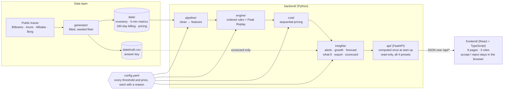
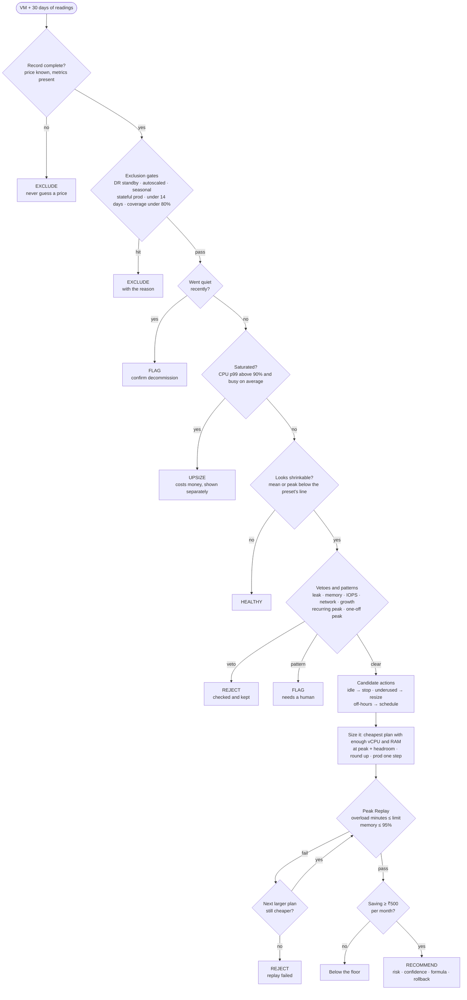
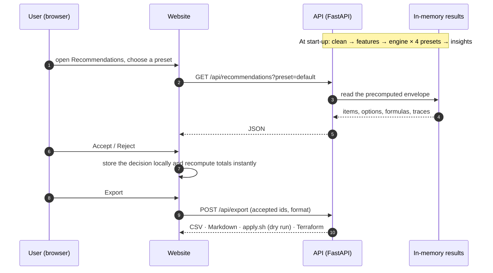
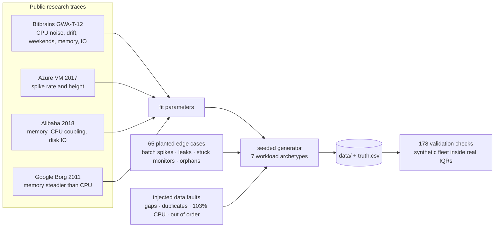

# SmartCloud Optimizer

**Finds wasted cloud spend and recommends only changes that are proven safe.** Every rupee comes with its formula, every downsize is replayed against 30 days of real peak load before it is recommended, and the tool shows what it *refused* to shrink, and why.

| Monthly bill | Potential saving | Changes | Unsafe downsizes | Scorecard |
|:---:|:---:|:---:|:---:|:---:|
| ₹6,19,489 | **₹1,24,313 / month (20.1%)** | 53 | **0** | 141 / 141 |

<sub>Default preset, prices ex-GST, on the bundled 30-day dataset (117 VMs, 15 volumes, 8 public IPs across Noida, Bangalore and Mumbai).</sub>

---

## Contents

1. [The problem](#1-the-problem)
2. [Our answer](#2-our-answer)
3. [High-level design](#3-high-level-design)
4. [Repository map](#4-repository-map)
5. [Key design decisions](#5-key-design-decisions)
6. [The money model](#6-the-money-model)
7. [Presets](#7-presets-choosing-a-risk-appetite)
8. [Quick start](#8-quick-start)
9. [Documentation](#9-documentation)
10. [Scope and assumptions](#10-scope-and-assumptions)
11. [Numbers cheat sheet](#11-numbers-cheat-sheet)

---

## 1. The problem

An Indian SaaS company's cloud bill grew **38.3% in six months**, from ₹4,35,004 to ₹6,01,691 per 30 billed days, and most of that growth came from test and development machines rather than from serving customers.

| Environment | First 30 days | Last 30 days | Growth |
|---|---:|---:|---:|
| Dev | ₹54,933 | ₹1,19,585 | **+₹64,652** |
| Staging | ₹41,882 | ₹91,597 | **+₹49,715** |
| Prod | ₹3,33,476 | ₹3,85,796 | +₹52,320 |
| **Total** | **₹4,35,004** | **₹6,01,691** | **+₹1,66,687** |

Dev and staging account for **69%** of the growth. Finding that waste is the easy part. Acting on it safely is harder:

- **Averages lie.** A server averaging 8% CPU looks wasteful, but if a batch job pins it at 93% every night at 2 AM, shrinking it breaks the job.
- **Trust is fragile.** One bad downsize that causes an outage, and engineers ignore the tool for good.
- **Finance needs the arithmetic.** "Save ₹1 lakh" means nothing without the formula, and two changes to one machine must not be counted twice.
- **Monitoring data is messy.** A stuck monitor reporting 0% would make a busy server look idle.

---

## 2. Our answer

| Feature | What it does | Why it matters |
|---|---|---|
| **Peak Replay** | Before recommending a smaller plan, replays all 8,640 five-minute readings from the last 30 days on that plan and counts the minutes above 90% CPU. | A percentile ignores the busiest 1% of time, and a short weekly job hides inside it. Replay checks every reading. |
| **Checked & kept** | Lists the machines that *look* wasteful on their average but were deliberately kept, each with the signal that stopped us and the overload a careless cut would have caused. | Proof that the safety checks ran. A tool that only ever says "shrink" is guessing. |
| **Engine Scorecard** | Grades the engine against the dataset's answer key: **141 / 141 correct, 0 unsafe downsizes.** | The engine never sees the answers; only the scorecard reads them. |

Around these sit a bill-growth explainer, four risk-appetite presets, a What-if planner, a 90-day forecast with a carbon view, alerts, a data-quality report, exports (CSV, Markdown, dry-run `apply.sh`, Terraform), and an Assumptions page that shows every number the engine uses.

---

## 3. High-level design

### 3.1 System architecture



**How it works.** Data flows one way: raw readings are cleaned, summarised into features, judged by the rule engine, priced, enriched with insights, and served. The API computes everything once at start-up, for all four presets, and serves it from memory. The website only reads.

**Why it is built this way.**

- **One settings file.** `config.yaml` holds every threshold, price and preset, each with a *why* and a *source*. The engine reads it and the Assumptions page displays the same file, so documentation cannot drift from logic.
- **A read-only server.** Accept and Reject live in the browser, so no click can change anything on the server, and totals update instantly. Decisions reach the server only to build an export.
- **The engine cannot cheat.** `truth.csv` is read by the scorecard alone, never by the engine.
- **Replaceable data source.** Only the loader in `backend/data_access.py` would change to read a real provider's inventory and monitoring; the engine, cost model and website stay as they are.

### 3.2 The decision pipeline

Every VM walks the same ordered checklist. The first firm verdict wins, and every check is written to a trace with its value, threshold and result.



**Why this order and these rules.**

- **Peaks, not averages.** Sizing reads the 99th percentile for production and the 95th for test machines, and Replay then checks every reading.
- **Data gates come first.** A decision on incomplete data is not a decision. Missing data is never treated as zero, because zero means idle.
- **Vetoes block shrinking on any one signal.** Memory, disk, network, growth, a leak or a recurring peak can each keep a machine whose CPU looks quiet.
- **Strict comparisons.** A value exactly on a threshold does not trigger it, which keeps behaviour predictable and testable.
- **Safety gates are preset-independent.** Peak Replay, the 95% memory cap and the production one-step rule are identical in every preset.

### 3.3 Request flow



**Why.** Every response is computed before the first request, so pages load instantly and every user sees the same numbers. Because decisions stay in the browser, the totals can never double-count: each resource contributes exactly one accepted option.

### 3.4 Data: realistic by construction



**Why synthetic data.** No real company's data was available, and real data has no answer key: nobody can say for certain which machine should be shrunk. So the generator was **fitted to four public research datasets** (it was not hand-tuned), and 65 tricky cases with known correct answers were planted so the engine can be graded. The data is seeded, so every build is identical.

### 3.5 Two engines, one dataset

| | `backend/engine/` | `engine/` |
|---|---|---|
| Role | **Production engine:** the one the API and website serve | **Reference engine:** used to choose and justify the logic |
| Configuration | `config.yaml` | `engine/config.yaml` |
| Distinctive work | Aligned to the website's data contract; runs all four presets at start-up | Scored 2–4 candidate logics per component (correctness, out-of-sample safety, explainability, robustness), plus the 1,000-VM benchmark |
| Default result | ₹1,24,313 saving on ₹6,19,489 | ₹1,23,452 saving on ₹6,15,989 |

Both follow the same rules and read the same data. The ₹3,500 difference in the bill is one legacy plan: the production engine prices it at its billed rate, while the reference engine treats its price as unknown and excludes it.

---

## 4. Repository map

| Path | Contents |
|---|---|
| `backend/` | FastAPI app (`api/`), cleaning and features (`pipeline/`), the decision engine (`engine/`), pricing (`cost/`), alerts, growth, forecast, What-if, export and scorecard (`insights/`) |
| `frontend/` | React + TypeScript + Vite website (9 pages, ECharts) with Playwright checkpoint tests |
| `engine/` | Reference engine: logic selection, reasoning ledger, presets report, 1,000-VM benchmark |
| `generator/` | Seeded data generator, trace fitting and data validation |
| `data/` | The dataset: inventory, metrics, billing, pricing, and the answer key |
| `config.yaml` | Every threshold, price and preset, each with its reason and source |
| `tests/` | Backend and engine test suites (every planted case is a test) |
| `requirements.txt` | Python dependencies |

---

## 5. Key design decisions

| Decision | Why |
|---|---|
| **Peaks, not averages** | `prod-batch-07` averages 7.7% but hits 92.5% every night; sizing on the average would break its batch job. |
| **p99 for production, p95 for test** | A production failure reaches customers. AWS Compute Optimizer defaults to p99.5; p99 is our conservative reading. |
| **Peak Replay on top of the percentile** | `dev-report-02`'s p95 is only 21%, yet Replay shows 240 minutes above 90% from a weekly job. |
| **30 days of data** | Above AWS's 14-day minimum and covers four weekly cycles; a Sunday-only job is invisible in 7 days. |
| **70% / 80% CPU target after a resize** | Leaves 20–30% headroom, in line with AWS guidance. |
| **Memory treated more strictly than CPU** | Running out of memory crashes a machine; running out of CPU only slows it (70% veto, 75% target, 95% cap). |
| **One plan step at a time in production** | Small, reversible moves. |
| **Always round up to the next plan** | Rounding down undersizes by definition. |
| **Missing data is never zero** | Zero means idle; a broken monitor would otherwise get a busy server stopped. |
| **Untagged machines are treated as production** | When we don't know, we assume the most careful case. |
| **₹500 saving floor** | People's attention is scarce; a list padded with trivia gets ignored. |
| **Rules, not machine learning** | Every decision must be explainable to the rupee: "kept because memory is 86% full, over the 70% limit." |
| **Schedules per machine, not one company-wide policy** | What-if shows that a blanket "dev off at night" policy would disrupt 12 machines. |
| **Alerts compare the same hour of the week** | A normal 2 AM batch never alerts; an unusual 2 AM spike does. |

---

## 6. The money model

**Price list** (illustrative, ex-GST, modelled on Utho's public Basic plans; all regions priced the same):

| Plan | vCPU | RAM (GB) | ₹ / month |
|---|---:|---:|---:|
| S1 | 1 | 2 | 705 |
| B1 | 2 | 4 | 1,410 |
| B2 | 4 | 8 | 2,826 |
| B3 | 6 | 16 | 3,978 |
| B4 | 8 | 32 | 6,690 |
| B5 | 16 | 64 | 13,000 |
| B6 | 24 | 96 | 25,962 |

Disks cost ₹8 per GB, snapshots ₹4 per GB and public IPs ₹200, each per month. A stopped machine pays only for its disk.

**The pricing rules**

- **Sequential, never additive.** When a machine is both resized and scheduled, the schedule is priced on the *smaller* plan. Adding the two savings separately would overstate the total.
- **Scheduling saves compute only**; disks keep billing while the machine is off.
- **Deletes subtract the snapshot** we keep first.
- **Upsizes cost money** and appear on their own "Risk fixes" line, never netted against savings.
- **Whole rupees throughout.** The headline total is the exact sum of the individual changes.

**Worked examples** (exactly as the app shows them):

| Resource and change | Formula | Saving / month |
|---|---|---:|
| `prod-api-07`: resize B4 → B3 (production, one step) | ₹6,690 B4 + ₹1,200 disk = ₹7,890 → ₹3,978 B3 + ₹1,200 disk = ₹5,178 | **₹2,712** |
| `dev-web-03`: resize B4 → B2 **and** switch off nights and weekends | ₹6,690 B4 + ₹1,600 disk = ₹8,290 → ₹2,826 B2 × 50/168 h on + ₹1,600 disk = ₹2,441 | **₹5,849** |
| `dev-tiny-14`: stop an idle machine (already the smallest plan) | ₹705 S1 + ₹1,600 disk = ₹2,305 → ₹0 compute while stopped + ₹1,600 disk = ₹1,600 | **₹705** |

---

## 7. Presets: choosing a risk appetite

A preset changes how wide the net of shrink candidates is and how much headroom a resized machine keeps. **It never changes the safety gates:** Peak Replay, the 95% memory cap and the production one-step rule are the same in all four.

| | Max savings | Balanced | **Default** | Max performance |
|---|:---:|:---:|:---:|:---:|
| Sizing percentile | p90 | p95 | p99 prod · p95 test | p99.5 |
| CPU target after a resize | 90% | 80% | 70% prod · 80% test | 60% |
| Replay overload allowed (min / month) | 60 | 30 | 0 prod · 30 test | 0 |
| Underused if CPU / memory below | 55% / 65% | 45% / 55% | 40% / 50% | 30% / 40% |
| Changes recommended | 54 | 54 | **53** | 48 |
| Potential saving / month | ₹1,25,465 | ₹1,25,465 | **₹1,24,313** | ₹1,10,588 |

**What this shows:** even the most aggressive preset saves under 1% more than Default. It examines more machines, but the extra candidates fail Peak Replay or lack the memory headroom to shrink. Safety is not something a preset can switch off.

---

## 8. Quick start

**Requirements:** Python 3.11+, Node.js 18+.

```bash
# 1. Backend API (http://localhost:8000, interactive docs at /docs)
pip install -r requirements.txt
uvicorn backend.api.main:app --port 8000

# 2. Website (http://localhost:5173, proxies /api to the backend)
cd frontend
npm install
npm run dev
```

**Tests**

```bash
pytest                      # backend and engine suites
cd frontend && npm run verify   # 16 browser checkpoints (Playwright)
```

**Rebuild and re-check the dataset (optional; the dataset is committed)**

```bash
python -m generator.build       # regenerate data/ (seeded, identical every time)
python -m generator.validate    # 178 data checks
```

**Reference engine (optional)**

```bash
python -m engine.run                    # reference recommendations and alerts
python -m engine.checkpoints --upto 13  # cumulative engine checkpoints
```

**API endpoints**

| Method | Endpoint | Returns |
|---|---|---|
| GET | `/api/recommendations?preset=` | One recommendation per resource: verdict, options, formulas, replay, risk, trace |
| GET | `/api/summary` | Bill, growth waterfall, before and after by environment, team and region |
| GET | `/api/resources`, `/api/resources/{id}` | Fleet table and a single resource |
| GET | `/api/resources/{id}/metrics`, `/api/resources/{id}/replay` | Time series and the Peak Replay projection |
| GET | `/api/alerts`, `/api/data-quality`, `/api/scorecard` | Alerts, data-quality report, engine scorecard |
| GET | `/api/forecast`, `/api/assumptions` | 90-day forecast; every threshold with its reason |
| POST | `/api/whatif`, `/api/export` | Off-hours policy simulation; CSV, Markdown, `apply.sh` or Terraform |

---

## 9. Documentation

| Document | Read it for |
|---|---|
| [`config.yaml`](config.yaml) | Every threshold, price and preset the app uses, each with its reason and source |
| [`ASSUMPTIONS.md`](ASSUMPTIONS.md) | Engine thresholds, presets, scorecard, alerts and benchmark in one place |
| [`data/DATASET.md`](data/DATASET.md) | How the dataset was generated and fitted, the planted cases and the injected faults |
| [`engine/REASONING.md`](engine/REASONING.md) | Why each logic was chosen and every number justified, with sensitivity analysis |
| [`frontend/API_CONTRACT.md`](frontend/API_CONTRACT.md) | The API the website relies on |
| [`frontend/README.md`](frontend/README.md) | Running and testing the website |

---

## 10. Scope and assumptions

- **Prices are illustrative**, ex-GST, modelled on Utho's public Basic plans. Real prices go into `config.yaml`; no code changes.
- **CPU is assumed to scale with core count** in Peak Replay. The error is contained by 20–30% headroom, one-step production moves and an undo step for every change.
- **The window is 30 days**, so yearly seasonality is handled by the `seasonal_peak` tag, which excludes festive-sale servers.
- **The dataset is synthetic but fitted** to four public research traces. The scorecard therefore measures the engine against our own planted answers; on real data the measure is whether accepted changes ever cause an incident.
- **Nothing is auto-applied.** Every recommendation carries before-and-after evidence and a rollback, and the generated script is a dry run by default.

---

## 11. Numbers cheat sheet

<sub>Default preset unless stated.</sub>

| Figure | Value |
|---|---|
| Fleet | 117 VMs, 15 volumes, 8 public IPs = 140 resources (+1 planted monitoring stream with no machine = 141 items) |
| Data | 30 days, one reading every 5 minutes, 8,640 readings per machine |
| Monthly bill (run-rate, ex-GST) | ₹6,19,489 |
| Bill growth over six months | +38.3% (₹4,35,004 → ₹6,01,691 per 30 days); 69% from dev and staging |
| Potential saving | **₹1,24,313 / month (20.1%)** from 53 changes |
| Waste (idle, orphaned, long-stopped) | ₹31,572 / month across 12 resources |
| Verdicts | 53 recommend · 26 kept by a veto or failed replay · 34 healthy · 21 excluded · 6 flagged · 1 upsize |
| Below the ₹500 floor | 1 item (₹495) |
| Scorecard | 141 / 141 correct, 0 unsafe downsizes |
| Alerts | 72 (7 critical, 64 warning, 1 info) |
| What-if: dev off 20:00–08:00 and weekends | 108 h off per week · blanket policy ₹65,241 but disrupts 12 machines · safe part ₹34,677 |
| Presets (saving / month) | Max savings ₹1,25,465 · Balanced ₹1,25,465 · Default ₹1,24,313 · Max performance ₹1,10,588 |
| Scale | 1,062 VMs and 86 lakh readings in about a minute on a single process (reference engine) |
