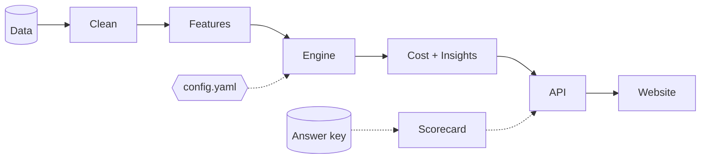
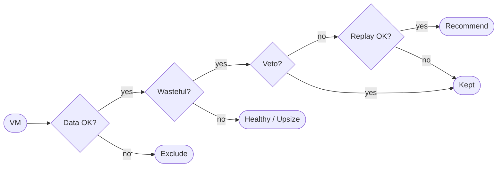

# SmartCloud Optimizer

> Finds wasted cloud spend and recommends **only changes proven safe** — every downsize is replayed against 30 days of real load, and every rupee shows its formula.

| Monthly bill | Potential saving | Changes | Unsafe downsizes | Scorecard |
|:---:|:---:|:---:|:---:|:---:|
| ₹6,19,489 | **₹1,24,313 (20.1%)** | 53 | **0** | 141 / 141 |

<sub>Default preset · ex-GST · 117 VMs, 15 volumes, 8 IPs across Noida, Bangalore, Mumbai · 30 days of 5-minute data</sub>

---

## Contents

[Problem](#problem) · [Features](#features) · [Architecture](#architecture) · [Decision engine](#decision-engine) · [Money model](#money-model) · [Presets](#presets) · [Quick start](#quick-start) · [API](#api) · [Repository](#repository) · [Docs](#docs) · [Assumptions](#assumptions)

---

## Problem

The bill grew **+38.3% in six months** (₹4,35,004 → ₹6,01,691 per 30 days). **69%** of that growth is dev and staging.

| Environment | Growth |
|---|---:|
| Dev | +₹64,652 |
| Staging | +₹49,715 |
| Prod | +₹52,320 |

**Why it's hard:** averages hide peaks, one bad downsize kills trust, finance needs the arithmetic, and monitoring data is messy.

---

## Features

| | |
|---|---|
| **Peak Replay** | Replays all 8,640 readings on the smaller plan before recommending it |
| **Checked & kept** | Lists what *looks* wasteful but was kept — with the reason |
| **Engine Scorecard** | Grades itself against the answer key: 141/141, 0 unsafe |
| **Bill growth explainer** | Waterfall by environment, team and new resources |
| **Presets** | Four risk appetites; safety checks never change |
| **What-if** | Tests off-hours policies before applying them |
| **Alerts** | Spikes, surges, capacity, leaks, cost jumps — each with a reason |
| **Exports** | CSV · Markdown · dry-run `apply.sh` · Terraform |

---

## Architecture



| Stage | Folder | Key point |
|---|---|---|
| Data | `data/` | Synthetic, fitted to 4 public cloud traces, seeded |
| Clean | `backend/pipeline/` | Missing data is never treated as zero |
| Features | `backend/pipeline/` | Percentiles, weekly rhythm, trends, leaks |
| Engine | `backend/engine/` | Ordered rules + Peak Replay, full trace |
| Cost + Insights | `backend/cost/`, `backend/insights/` | Sequential pricing, alerts, forecast, what-if |
| API | `backend/api/` | Computed once at start-up, read-only |
| Website | `frontend/` | Accept / reject stays in the browser |

**Why this shape**
- **One settings file** — every threshold has a reason; the Assumptions page shows the same file.
- **Read-only server** — no click can break anything; totals update instantly.
- **Engine never sees the answer key** — only the scorecard does.
- **Swappable data source** — only the loader changes for a real provider.

---

## Decision engine



| Rule | Value | Why |
|---|---|---|
| Sizing peak | p99 prod · p95 test | Averages hide the moments that break machines |
| CPU target after resize | 70% prod · 80% test | 20–30% headroom (AWS guidance) |
| Memory | veto 70% · target 75% · cap 95% | Out of memory crashes; out of CPU only slows |
| Replay limit | 0 min prod · 30 min/month test above 90% | Hard safety gate |
| Production moves | One plan step at a time | Small, reversible changes |
| Vetoes | Memory · disk · network · growth · leak · recurring peak | Any one blocks shrinking |
| Minimum data | 14 days · 80% coverage | Below that, we don't decide |
| Saving floor | ₹500 / month | Not worth anyone's time below this |

**Example:** `prod-batch-07` averages **7.7%** CPU — a careless tool shrinks it. Replay shows **1,195 minutes above 90%** from its 2 AM batch job → **kept**.

---

## Money model

| Rule | |
|---|---|
| Sequential, never additive | Resize + schedule is priced as one change |
| Scheduling | Saves compute only; disks keep billing |
| Deletes | Subtract the snapshot kept first |
| Upsizes | Shown separately as "Risk fixes" |
| Totals | Whole rupees; headline = sum of the cards |

| Change | Before → After | Saving / month |
|---|---|---:|
| `prod-api-07` resize B4 → B3 | ₹7,890 → ₹5,178 | **₹2,712** |
| `dev-web-03` resize B4 → B2 + off nights & weekends | ₹8,290 → ₹2,441 | **₹5,849** |
| `dev-tiny-14` stop idle machine | ₹2,305 → ₹1,600 | **₹705** |

<details>
<summary><b>Price list</b> (illustrative, ex-GST, modelled on Utho Basic plans)</summary>

| Plan | vCPU | RAM | ₹ / month |
|---|---:|---:|---:|
| S1 | 1 | 2 GB | 705 |
| B1 | 2 | 4 GB | 1,410 |
| B2 | 4 | 8 GB | 2,826 |
| B3 | 6 | 16 GB | 3,978 |
| B4 | 8 | 32 GB | 6,690 |
| B5 | 16 | 64 GB | 13,000 |
| B6 | 24 | 96 GB | 25,962 |

Disk ₹8/GB · Snapshot ₹4/GB · Public IP ₹200 — per month.

</details>

---

## Presets

| | Max savings | Balanced | **Default** | Max performance |
|---|:---:|:---:|:---:|:---:|
| Sizing percentile | p90 | p95 | p99 / p95 | p99.5 |
| CPU target | 90% | 80% | 70% / 80% | 60% |
| Changes | 54 | 54 | **53** | 48 |
| Saving / month | ₹1,25,465 | ₹1,25,465 | **₹1,24,313** | ₹1,10,588 |

Safety checks are identical in every preset — even Max savings adds **< 1%**.

---

## Quick start

```bash
# Backend  → http://localhost:8000  (docs at /docs)
pip install -r requirements.txt
uvicorn backend.api.main:app --port 8000

# Website  → http://localhost:5173
cd frontend && npm install && npm run dev
```

```bash
pytest                          # backend + engine tests
cd frontend && npm run verify   # 16 browser checkpoints
python -m generator.validate    # 178 data checks
```

---

## API

| Method | Endpoint | Returns |
|---|---|---|
| GET | `/api/recommendations?preset=` | Verdicts, options, formulas, replay, risk, trace |
| GET | `/api/summary` | Bill, growth, before/after |
| GET | `/api/resources` · `/api/resources/{id}` | Fleet and one resource |
| GET | `/api/resources/{id}/metrics` · `/replay` | Time series, Replay projection |
| GET | `/api/alerts` · `/api/data-quality` · `/api/scorecard` | Alerts, data report, scorecard |
| GET | `/api/forecast` · `/api/assumptions` | Forecast, every threshold |
| POST | `/api/whatif` · `/api/export` | Policy simulation, exports |

---

## Repository

| Path | |
|---|---|
| `backend/` | API, pipeline, engine, cost, insights |
| `frontend/` | React + TypeScript website |
| `engine/` | Reference engine — how each rule was chosen and scored |
| `generator/` | Seeded data generator, fitted to public traces |
| `data/` | Dataset + answer key |
| `config.yaml` | Every threshold and price, with its reason |
| `tests/` | Test suites |

---

## Docs

| Document | For |
|---|---|
| [`ASSUMPTIONS.md`](ASSUMPTIONS.md) | Thresholds, presets, scorecard, benchmark |
| [`data/DATASET.md`](data/DATASET.md) | How the data was built |
| [`engine/REASONING.md`](engine/REASONING.md) | Why each rule and number was chosen |
| [`frontend/API_CONTRACT.md`](frontend/API_CONTRACT.md) | API used by the website |

---

## Assumptions

- Prices are illustrative (ex-GST); real prices go in `config.yaml`.
- CPU is assumed to scale with core count — covered by headroom and one-step moves.
- 30-day window; seasonal servers are excluded by tag.
- Data is synthetic, fitted to real traces.
- Nothing is auto-applied — scripts are dry runs with an undo for every step.
